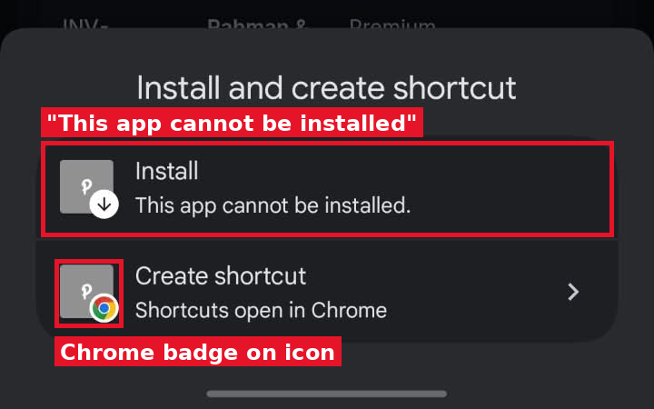

# 16 — Make the app installable on phones with the company "PI" icon

**Project:** Power International BD ERP

## Screenshots

*`screenshots/16-pwa-cannot-install.png` — Android Chrome: Install says "This app cannot be installed"; the shortcut icon has a Chrome badge*

## Context (from the client meeting)
On an Android phone, Chrome's menu offers "Install" and "Create shortcut". Choosing Install shows "This app cannot be installed", so only a shortcut is created, and that shortcut shows a small "P" badge on top of the Chrome logo. The client wants a real installed app: its own full-size Power International icon on the home screen, opening without the browser bar, like a normal app.

## Current behaviour (code)
- Check `src/app/layout.tsx` (`metadata.icons`) and `public/` for an existing web app manifest, icons and service worker. The client sees the "cannot be installed" message, so at least one installability requirement is missing.

## Required change
1. Add a web app manifest (Next.js `app/manifest.ts` or `public/manifest.webmanifest`): `name` "Power International BD ERP", `short_name` (e.g. "Power ERP"), `start_url` "/admin/dashboard" (or the post-login landing page), `scope` "/", `display` "standalone", `theme_color` and `background_color` matching the brand.
2. Generate icons from the existing company logo: 192×192 and 512×512 PNG, plus maskable versions with safe padding so Android does not crop the logo, and an `apple-touch-icon` (180×180) for iPhone. Put them in `public/icons/`.
3. Add a minimal service worker (registered only in production) so every Chrome version treats the site as installable. It must not cache API responses or Firebase data; network-first for pages is enough. Keep it small and easy to remove.
4. Link the manifest and icons in the root layout metadata. Set the mobile theme colour for both light and dark mode.
5. The dealer portal (`/portal`) should install the same way if it is a separate entry point; ask me if you think it needs its own manifest.

## Acceptance criteria
- [ ] Chrome DevTools → Application → Manifest shows no installability errors.
- [ ] Lighthouse "Installable" check passes on a production build.
- [ ] On Android Chrome, "Install" adds an app with the full PI icon (no Chrome badge) that opens without the address bar.
- [ ] Logging in, live data updates and logging out work the same inside the installed app.

## Notes
Use the company logo that is already in the app header. If no high-resolution version exists, tell me and I will provide one.

## Working rules
- Open and look at the screenshot(s) above before starting; red boxes mark the area this task is about.
- The screenshots were taken from the live site in the second client meeting, before prompts 01–15 were deployed. The current code already differs in places (dates are DD/MM/YYYY, the sales status is a badge, "New sale" is gone, two-stage approval exists). Read the current code before planning.
- Show me your plan before changing code. Do not commit anything.
- Run tests only on the local emulator (`npm run test:e2e:local`), never against the live database.
- Keep the change scoped to this task. Match the existing stack: Next.js App Router, TypeScript, Tailwind, shadcn/ui, `useERP()` in `src/lib/erp/provider.tsx`, Firebase Realtime Database.
- Keep two-stage approval (prompt 02) and the ledger as the single source of dealer due intact.
- Must work on a 360px phone and in dark mode. Dates in DD/MM/YYYY.
- At the end, summarise changed files, tests run, and anything assumed or left undone.
