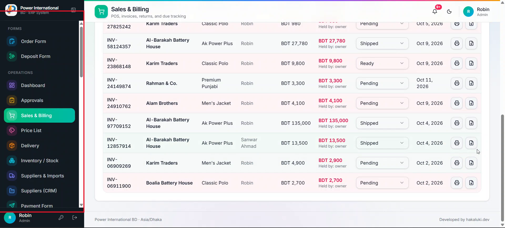

# 17 — Sidebar: white in light mode, no visible scrollbar

**Project:** Power International BD ERP

## Screenshots

*`screenshots/22-sidebar-dark-scrollbar.png` — The sidebar stays dark in light mode and shows a scrollbar*

## Context (from the client meeting)
In light mode the sidebar is still black while the rest of the page is white, and its scrollbar looks bad on the black background. The team wants: light mode = whole app white (sidebar included), dark mode = whole app dark as now, and the sidebar scrolls without a visible scrollbar.

## Current behaviour (code)
- The sidebar lives in `src/components/admin/AdminShell.tsx` and uses fixed dark colours instead of theme tokens.

## Required change
1. Use theme tokens for the sidebar background, text, borders, hover and active states so it is white/light in light mode and keeps its current dark look in dark mode.
2. Keep each menu item's coloured icon and the coloured active pill readable in both themes (check contrast).
3. Hide the sidebar's scrollbar (scrollbar-width: none and the webkit equivalent) while keeping mouse-wheel, touch and keyboard scrolling.
4. Apply the same to the mobile "All modules" sheet and the collapsed sidebar, if they use the same styles.

## Acceptance criteria
- [ ] Light mode: sidebar white, matching the page; dark mode unchanged.
- [ ] No scrollbar visible in the sidebar, and it still scrolls on desktop and phone.
- [ ] Screenshots in both themes at desktop and 360px.

## Working rules
- Open and look at the screenshot(s) above before starting; red boxes mark the area this task is about.
- The screenshots were taken from the live site in the second client meeting, before prompts 01–15 were deployed. The current code already differs in places (dates are DD/MM/YYYY, the sales status is a badge, "New sale" is gone, two-stage approval exists). Read the current code before planning.
- Show me your plan before changing code. Do not commit anything.
- Run tests only on the local emulator (`npm run test:e2e:local`), never against the live database.
- Keep the change scoped to this task. Match the existing stack: Next.js App Router, TypeScript, Tailwind, shadcn/ui, `useERP()` in `src/lib/erp/provider.tsx`, Firebase Realtime Database.
- Keep two-stage approval (prompt 02) and the ledger as the single source of dealer due intact.
- Must work on a 360px phone and in dark mode. Dates in DD/MM/YYYY.
- At the end, summarise changed files, tests run, and anything assumed or left undone.
