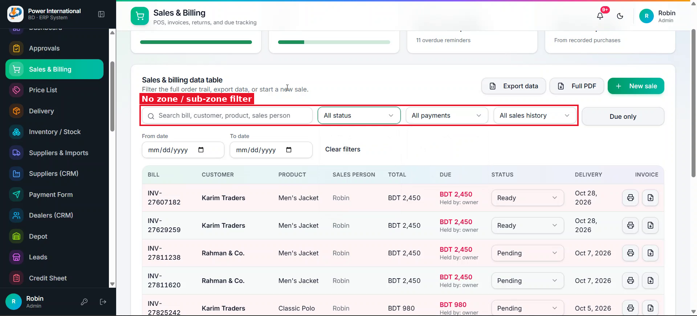

# 18 — Sales & Billing: filter by zone and sub-zone

**Project:** Power International BD ERP

## Screenshots

*`screenshots/23-sales-search-no-zone.png` — Search and filters on the Sales & Billing table: no zone or sub-zone option*

## Context (from the client meeting)
The client can search sales by customer, product and sales person, but not by zone or sub-zone, which is how the business is organised.

## Current behaviour (code)
- `src/components/admin/SalesScreen.tsx` has a search box plus status, payment and history filters.
- Zones and sub-zones already exist for dealers (Credit sheet → zone manager, `customers` page).

## Required change
1. Add a Zone filter and a Sub-zone filter next to the existing filters. Sub-zone lists only the sub-zones of the selected zone; changing the zone resets it.
2. An order matches by its dealer's zone/sub-zone. Use the dealer's current zone unless the order already stores its own zone; tell me which one you used.
3. The search box also matches zone and sub-zone names.
4. The filters also apply to Export data and Full PDF, and "Clear filters" resets them.
5. Respect the user's zone scope: a user limited to some zones sees only those zones in the dropdown.

## Acceptance criteria
- [ ] Choosing a zone shows only that zone's orders; adding a sub-zone narrows further.
- [ ] Excel and PDF contain only the filtered rows.
- [ ] Works at 360px.

## Working rules
- Open and look at the screenshot(s) above before starting; red boxes mark the area this task is about.
- The screenshots were taken from the live site in the second client meeting, before prompts 01–15 were deployed. The current code already differs in places (dates are DD/MM/YYYY, the sales status is a badge, "New sale" is gone, two-stage approval exists). Read the current code before planning.
- Show me your plan before changing code. Do not commit anything.
- Run tests only on the local emulator (`npm run test:e2e:local`), never against the live database.
- Keep the change scoped to this task. Match the existing stack: Next.js App Router, TypeScript, Tailwind, shadcn/ui, `useERP()` in `src/lib/erp/provider.tsx`, Firebase Realtime Database.
- Keep two-stage approval (prompt 02) and the ledger as the single source of dealer due intact.
- Must work on a 360px phone and in dark mode. Dates in DD/MM/YYYY.
- At the end, summarise changed files, tests run, and anything assumed or left undone.
