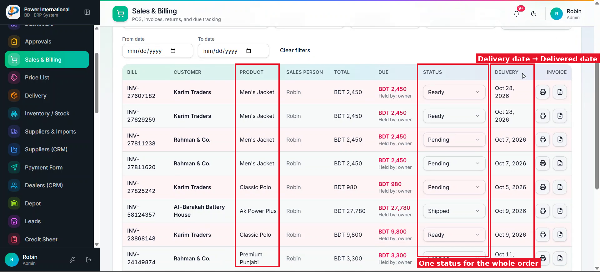

# 19 — Show "Delivered date" (actual delivery) instead of the planned delivery date

**Project:** Power International BD ERP

## Screenshots

*`screenshots/20-sales-delivery-and-status.png` — The Delivery column shows the planned date entered when the order was submitted*

## Context (from the client meeting)
The Delivery column shows the date chosen on the order form. The client wants the date the goods were actually delivered. If the order is not delivered yet, the cell is empty. It must fill in automatically when the order reaches delivered in the workflow.

## Current behaviour (code)
- Orders store `deliveryDate` (planned). There is no field for the actual delivery date.
- The delivery workflow sets the status to shipped/completed in `provider.tsx` (posting a delivery and submitting the delivery document). Statuses are configurable (prompt 14).

## Required change
1. Add `deliveredAt` (date) to orders. Set it automatically when the order reaches its delivered state: when the delivery document is submitted, and when someone sets a final/delivered status manually. Clearing that status clears the date.
2. Rename the table column to "Delivered date". Show `deliveredAt` in DD/MM/YYYY, or an empty cell when not delivered.
3. Keep the planned date in the order dialog and on the invoice as "Planned delivery".
4. Update the column picker (prompt 15), Excel and PDF exports.
5. Do not backfill old orders. They show empty unless you can find the real delivery date in delivery records; if you can, write a dry-run script and show me first.

## Acceptance criteria
- [ ] A new order shows an empty Delivered date; after delivery it shows that day's date.
- [ ] Exports use the new column.

## Notes
If item-level status (prompt 20) is done later, the order's delivered date becomes the day its last item is delivered.

## Working rules
- Open and look at the screenshot(s) above before starting; red boxes mark the area this task is about.
- The screenshots were taken from the live site in the second client meeting, before prompts 01–15 were deployed. The current code already differs in places (dates are DD/MM/YYYY, the sales status is a badge, "New sale" is gone, two-stage approval exists). Read the current code before planning.
- Show me your plan before changing code. Do not commit anything.
- Run tests only on the local emulator (`npm run test:e2e:local`), never against the live database.
- Keep the change scoped to this task. Match the existing stack: Next.js App Router, TypeScript, Tailwind, shadcn/ui, `useERP()` in `src/lib/erp/provider.tsx`, Firebase Realtime Database.
- Keep two-stage approval (prompt 02) and the ledger as the single source of dealer due intact.
- Must work on a 360px phone and in dark mode. Dates in DD/MM/YYYY.
- At the end, summarise changed files, tests run, and anything assumed or left undone.
