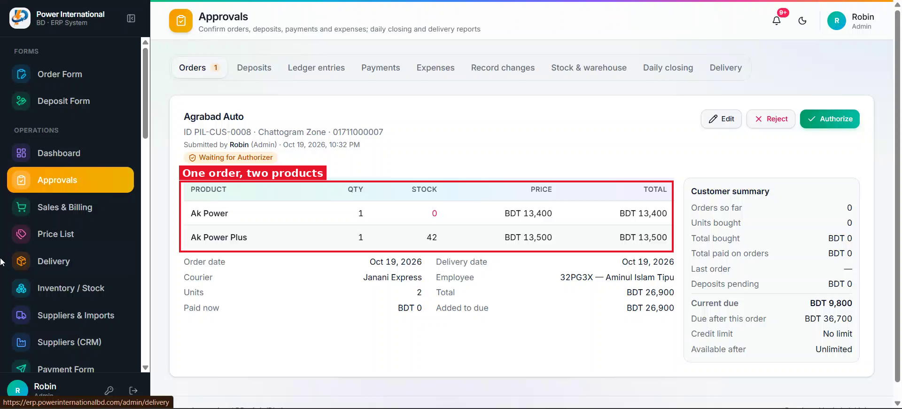
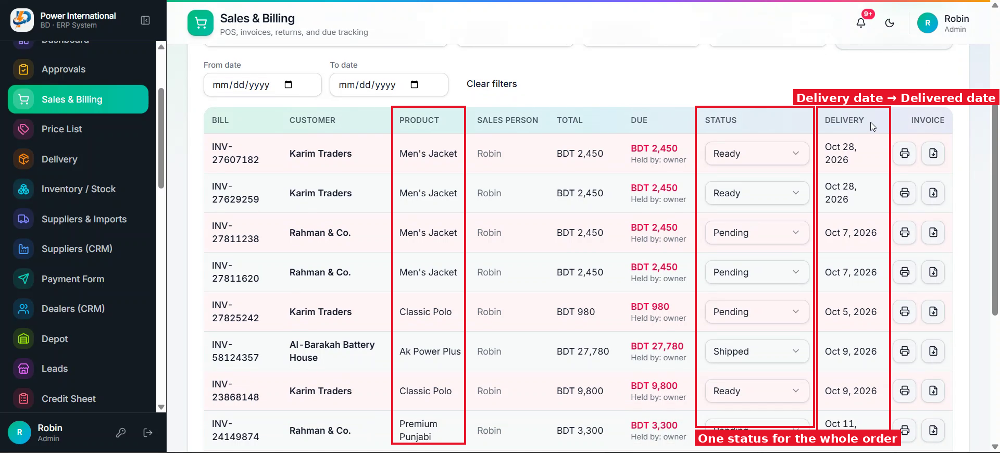

# 20 — Per-product status inside an order (partial delivery)

**Project:** Power International BD ERP

## Screenshots

*`screenshots/21-order-with-two-products.png` — One order with two products*

*`screenshots/20-sales-delivery-and-status.png` — The table has one status for the whole order*

## Context (from the client meeting)
An order can contain several products, for example one Polo and one Classic. Today the whole order has one status. The client asked: if the Polo is delivered and the Classic is not, how is that recorded? He wants a dropdown under the order row listing each product with its own status.

## Current behaviour (code)
- Orders have one `status`. Items are `order.items[]` with product, qty and price.
- The row already opens an invoice dialog (prompt 11). Statuses are configurable (prompt 14). Delivery flow is in `provider.tsx` and `src/app/admin/delivery`.

## Required change
1. First, show me a plan. Do not start coding until I approve.
2. Give each order item its own status (using the configured status list) and its own `deliveredAt`.
3. Add an expand arrow to each sales table row. Expanding shows a small sub-table: Product | Qty | Status | Delivered date. On phones it shows as a stacked list.
4. The order's own status is derived from its items. All items the same → that status. Mixed → a "Partially delivered" state (propose how to show it without adding a fake status to the list). Explain the rule in the plan.
5. Changing an item's status needs the same permission as changing an order's status today, and is logged in the audit like order status changes.
6. Delivery: explain in the plan how this fits the current To post → Posted → Submitted flow. The client is redesigning delivery (see prompt 23), so keep the delivery pages unchanged for now unless a change is required.

## Acceptance criteria
- [ ] A 2-item order where only one item is delivered shows as partially delivered, and the expanded row shows which one.
- [ ] When both items are delivered, the order becomes delivered and gets its Delivered date.

## Notes
Partial quantities (e.g. 6 of 10 pieces delivered) were not requested. Ask me before adding them.

## Working rules
- Open and look at the screenshot(s) above before starting; red boxes mark the area this task is about.
- The screenshots were taken from the live site in the second client meeting, before prompts 01–15 were deployed. The current code already differs in places (dates are DD/MM/YYYY, the sales status is a badge, "New sale" is gone, two-stage approval exists). Read the current code before planning.
- Show me your plan before changing code. Do not commit anything.
- Run tests only on the local emulator (`npm run test:e2e:local`), never against the live database.
- Keep the change scoped to this task. Match the existing stack: Next.js App Router, TypeScript, Tailwind, shadcn/ui, `useERP()` in `src/lib/erp/provider.tsx`, Firebase Realtime Database.
- Keep two-stage approval (prompt 02) and the ledger as the single source of dealer due intact.
- Must work on a 360px phone and in dark mode. Dates in DD/MM/YYYY.
- At the end, summarise changed files, tests run, and anything assumed or left undone.
