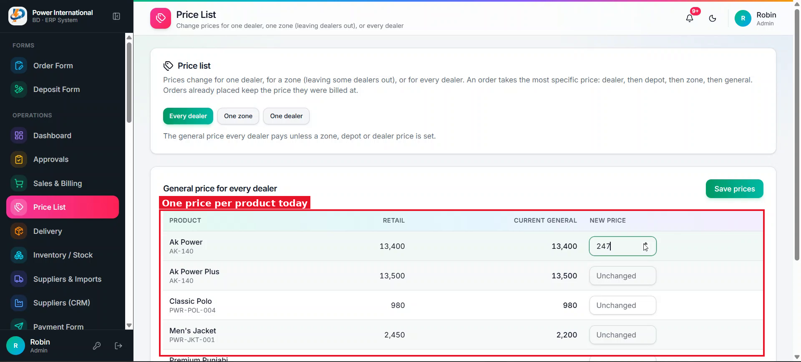
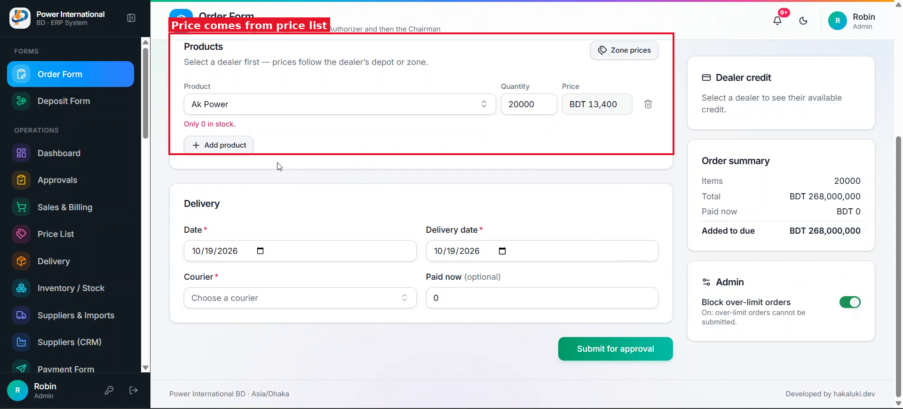

# 21 — Quantity-based prices (tiers) in the Price List, applied on the Order Form

**Project:** Power International BD ERP

## Screenshots

*`screenshots/24-price-list-general.png` — General price list: one price per product today*

*`screenshots/25-order-form-products.png` — Order Form: the price comes from the price list*

## Context (from the client meeting)
The client wants the price to depend on quantity. Example for Ak Power Plus: 1+ pcs = 13,400, 5+ pcs = 13,200, 10+ pcs = 13,000. On the Order Form, typing quantity 5 should pick 13,200 automatically, and 10 should pick 13,000. (He calls this "variant price".)

## Current behaviour (code)
- Price List (`src/app/admin/price-list`) has General / One zone / One dealer prices. The order form resolves the most specific one: dealer → depot → zone → general.

## Required change
1. In the Price List's general prices, each product gets a "+" button that adds a tier row: Minimum quantity | Price. The first tier is min 1 = the normal price. Tiers can be edited and removed. Validate: minimums are unique and increasing.
2. Tier prices apply to every dealer by default.
3. Precedence: if a dealer, depot or zone price for that product is saved AFTER the tiers were last saved, that newer price wins for those dealers. If the tiers were saved after it, the tiers win. Store an `updatedAt` on each price so this can be compared, and show in the Price List which price currently applies ("From" column).
4. Order Form: when a product has tiers, the price is picked from the highest tier whose minimum ≤ the quantity, and updates when the quantity changes. Show a small "Qty price" label on that line.
5. Order Form: add a "Use quantity prices" toggle (on by default) for the whole order. When off, the normal dealer/depot/zone/general price is used.
6. The order request and the approved order store the unit price actually used and whether a tier was applied, so later price changes never change old orders. Approval cards show it.

## Acceptance criteria
- [ ] Qty 1 → 13,400, qty 5 → 13,200, qty 12 → 13,000.
- [ ] Toggle off → normal price.
- [ ] A dealer price saved after the tiers wins for that dealer; saving the tiers again makes the tiers win.
- [ ] Existing orders keep their prices.

## Notes
Do not add approval for price changes in this task; the client has not decided yet.

## Working rules
- Open and look at the screenshot(s) above before starting; red boxes mark the area this task is about.
- The screenshots were taken from the live site in the second client meeting, before prompts 01–15 were deployed. The current code already differs in places (dates are DD/MM/YYYY, the sales status is a badge, "New sale" is gone, two-stage approval exists). Read the current code before planning.
- Show me your plan before changing code. Do not commit anything.
- Run tests only on the local emulator (`npm run test:e2e:local`), never against the live database.
- Keep the change scoped to this task. Match the existing stack: Next.js App Router, TypeScript, Tailwind, shadcn/ui, `useERP()` in `src/lib/erp/provider.tsx`, Firebase Realtime Database.
- Keep two-stage approval (prompt 02) and the ledger as the single source of dealer due intact.
- Must work on a 360px phone and in dark mode. Dates in DD/MM/YYYY.
- At the end, summarise changed files, tests run, and anything assumed or left undone.
