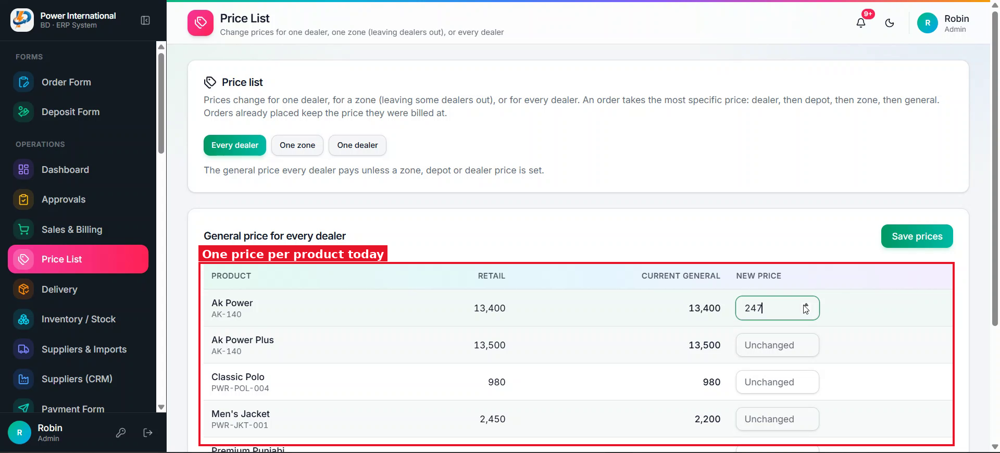
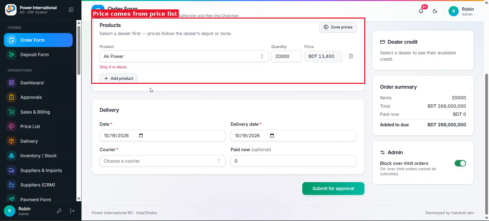

# 22 — Cash price and a Credit / Cash choice on the Order Form

**Project:** Power International BD ERP

## Screenshots

*`screenshots/24-price-list-general.png` — Price List*

*`screenshots/25-order-form-products.png` — Order Form*

## Context (from the client meeting)
The business mostly sells on credit, and credit prices are higher. A dealer who pays cash should get a lower cash price. Cash orders ignore the quantity tiers (prompt 21) and use the cash price.

## Current behaviour (code)
- The Order Form has no sale type. Payment (prompt 10) is an optional section.

## Required change
1. Price List: add a "Cash price" field per product in the general price list. Empty means no cash price; then a cash order falls back to the normal price with a warning.
2. Order Form: add "Sale type: Credit / Cash" (default Credit).
3. Cash: every line uses the product's cash price, the quantity-price toggle is hidden, and the Payment section opens with Paid now = Payable (editable).
4. Credit: current behaviour (with tiers from prompt 21).
5. Store the sale type on the order request and the order. Show it in approvals, the sales table (as a small badge and a filter), the invoice and exports.

## Acceptance criteria
- [ ] Switching a filled order from Credit to Cash changes every line to the cash price and back again.
- [ ] A cash order's invoice shows "Cash".

## Notes
Assumptions to confirm with the client, listed in your report: the cash price is one price for all dealers (no zone/dealer cash prices), and a cash order is expected to be paid in full but the amount stays editable.

## Working rules
- Open and look at the screenshot(s) above before starting; red boxes mark the area this task is about.
- The screenshots were taken from the live site in the second client meeting, before prompts 01–15 were deployed. The current code already differs in places (dates are DD/MM/YYYY, the sales status is a badge, "New sale" is gone, two-stage approval exists). Read the current code before planning.
- Show me your plan before changing code. Do not commit anything.
- Run tests only on the local emulator (`npm run test:e2e:local`), never against the live database.
- Keep the change scoped to this task. Match the existing stack: Next.js App Router, TypeScript, Tailwind, shadcn/ui, `useERP()` in `src/lib/erp/provider.tsx`, Firebase Realtime Database.
- Keep two-stage approval (prompt 02) and the ledger as the single source of dealer due intact.
- Must work on a 360px phone and in dark mode. Dates in DD/MM/YYYY.
- At the end, summarise changed files, tests run, and anything assumed or left undone.
