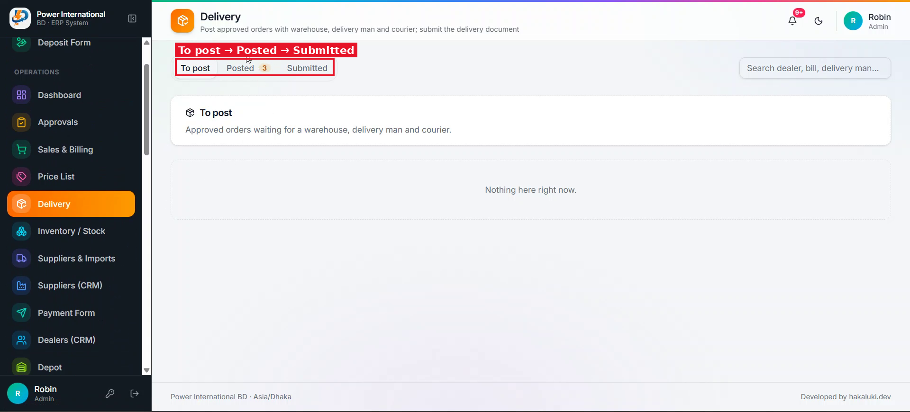
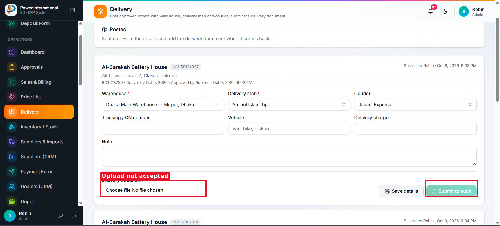

# 23 — Delivery: fix the document upload and write a plain explanation of the flow

**Project:** Power International BD ERP

## Screenshots

*`screenshots/26-delivery-tabs.png` — Delivery page: To post → Posted → Submitted*

*`screenshots/27-delivery-document-upload.png` — The delivery document upload does not accept the file, so "Submit to audit" stays disabled*

## Context (from the client meeting)
The client tried to finish a delivery: he chose a delivery document (photo/JPG), but the upload was not accepted, so three orders are stuck in "Posted". He did not understand the To post / Posted / Submitted steps or who is supposed to do each one. He said he will redesign delivery later; for now we fix the bug and explain the current flow.

## Current behaviour (code)
- `src/app/admin/delivery/page.tsx` uses `uploadImageToCloudinary` from `src/lib/cloudinary`. The Cloudinary env vars are `NEXT_PUBLIC_CLOUDINARY_CLOUD_NAME`, `NEXT_PUBLIC_CLOUDINARY_UPLOAD_PRESET` and `NEXT_PUBLIC_CLOUDINARY_FOLDER`.

## Required change
1. Reproduce the upload failure with a phone photo (JPG/HEIC, a few MB) and a PDF. Find the cause (file type, size, preset, unsigned upload settings, error swallowed) and fix it.
2. Show a clear error message and an upload progress indicator, accept JPG/PNG/HEIC/PDF, and compress large photos before upload.
3. Write `docs/DELIVERY-FLOW.md` in simple Bangla (Bengali script) for the client: what each tab means, what triggers each step, who can do it today (which permission), what data each step changes (status, stock, dates), and what the document is for. Add a short list of open questions for the client.
4. Do not redesign the delivery flow. List anything that looks unfinished or confusing as "On hold until the client's redesign" at the end of the document.

## Acceptance criteria
- [ ] A phone photo uploads and "Submit to audit" becomes available.
- [ ] The 3 stuck orders can be completed in the emulator copy.
- [ ] docs/DELIVERY-FLOW.md exists and a non-technical reader can follow it.

## Notes
Test uploads in a way that does not fill the real Cloudinary folder with test files, or delete them afterwards and tell me which ones.

## Working rules
- Open and look at the screenshot(s) above before starting; red boxes mark the area this task is about.
- The screenshots were taken from the live site in the second client meeting, before prompts 01–15 were deployed. The current code already differs in places (dates are DD/MM/YYYY, the sales status is a badge, "New sale" is gone, two-stage approval exists). Read the current code before planning.
- Show me your plan before changing code. Do not commit anything.
- Run tests only on the local emulator (`npm run test:e2e:local`), never against the live database.
- Keep the change scoped to this task. Match the existing stack: Next.js App Router, TypeScript, Tailwind, shadcn/ui, `useERP()` in `src/lib/erp/provider.tsx`, Firebase Realtime Database.
- Keep two-stage approval (prompt 02) and the ledger as the single source of dealer due intact.
- Must work on a 360px phone and in dark mode. Dates in DD/MM/YYYY.
- At the end, summarise changed files, tests run, and anything assumed or left undone.
