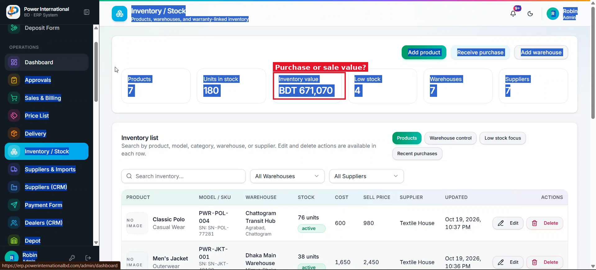

# 24 — Inventory value: make it clear it is the purchase (cost) value

**Project:** Power International BD ERP

## Screenshots

*`screenshots/28-inventory-value.png` — "Inventory value BDT 671,070" on the Inventory page*

## Context (from the client meeting)
The client asked whether "Inventory value" is calculated from purchase price or selling price; nobody could answer in the meeting. He wants it written clearly.

## Current behaviour (code)
- Check how the Inventory / Stock card computes the value (stock × purchase cost or × selling price).

## Required change
1. Confirm the formula and tell me which one it is today.
2. It should be stock × purchase cost. If it uses selling price, change it.
3. Rename the card to "Inventory value (purchase cost)" and add a one-line helper text: "Units in stock × purchase cost".
4. Optionally add a second small line "At selling price: BDT …" so both are visible. Check every other place that shows stock value (warehouse report, dashboard) uses the same formula and wording.

## Acceptance criteria
- [ ] The card label states the basis, and the number matches stock × purchase cost summed over all products.

## Working rules
- Open and look at the screenshot(s) above before starting; red boxes mark the area this task is about.
- The screenshots were taken from the live site in the second client meeting, before prompts 01–15 were deployed. The current code already differs in places (dates are DD/MM/YYYY, the sales status is a badge, "New sale" is gone, two-stage approval exists). Read the current code before planning.
- Show me your plan before changing code. Do not commit anything.
- Run tests only on the local emulator (`npm run test:e2e:local`), never against the live database.
- Keep the change scoped to this task. Match the existing stack: Next.js App Router, TypeScript, Tailwind, shadcn/ui, `useERP()` in `src/lib/erp/provider.tsx`, Firebase Realtime Database.
- Keep two-stage approval (prompt 02) and the ledger as the single source of dealer due intact.
- Must work on a 360px phone and in dark mode. Dates in DD/MM/YYYY.
- At the end, summarise changed files, tests run, and anything assumed or left undone.
