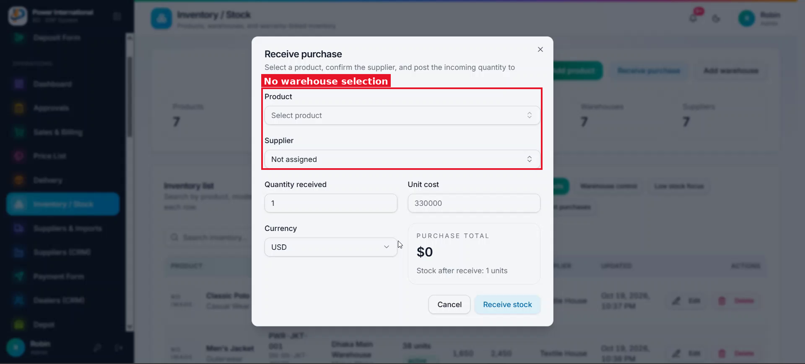
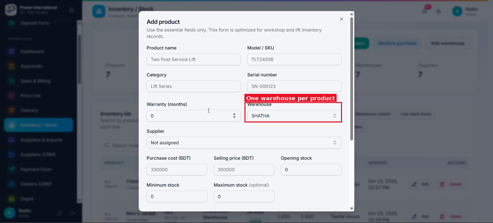

# 25 — Receive stock into chosen warehouses; one product in several warehouses

**Project:** Power International BD ERP

## Screenshots

*`screenshots/29-receive-purchase-no-warehouse.png` — Receive purchase: no warehouse selection*

*`screenshots/30-add-product-single-warehouse.png` — Add product: a product belongs to exactly one warehouse*

## Context (from the client meeting)
When stock is received, the client cannot choose the warehouse. And a product can only live in one warehouse: putting the same product in two warehouses creates two separate products. In reality, 20 pieces received may be split, e.g. 12 to Dhaka and 8 to Chattogram.

## Current behaviour (code)
- `Product` has a single `warehouseId` and a single `stockQty`.
- Receive purchase (now via two-stage approval, prompt 02) adds to `stockQty`.
- Order Form stock checks, delivery (warehouse chosen at posting), warehouse report (prompt 07) and new stock table (prompt 08) all read the single fields.

## Required change
1. First, show me a plan. Do not start coding until I approve. This is a data-model change.
2. Model: per-warehouse stock for each product, e.g. `stockByWarehouse: { [warehouseId]: qty }`. `stockQty` becomes the total (kept in sync, or derived). Explain the choice.
3. Receive purchase: add warehouse allocation rows (Warehouse | Qty) with a "+" to split across warehouses; the rows must add up to the quantity received. Stock moves only at final approval.
4. Add product: the opening stock also gets a warehouse (or split).
5. Delivery/sale: stock is taken from the warehouse chosen when the delivery is posted. If no warehouse is chosen yet, explain how you handle it.
6. Add a "Transfer stock" action (from warehouse → to warehouse, qty) that goes through the same two-stage approval.
7. Update the warehouse report (prompt 07), new stock table (prompt 08), inventory list, low-stock checks and the order form's "Only N in stock" message.
8. Migration script (dry run by default, --apply needs --backup outside the repo): move each product's current stock into `stockByWarehouse[product.warehouseId]`. Also detect products that look like duplicates of the same item in different warehouses (same name/model) and list them; do not merge them automatically.

## Acceptance criteria
- [ ] Receiving 20 as 12 + 8 into two warehouses shows 12 and 8 in the warehouse report and 20 in total.
- [ ] A transfer of 5 moves stock only after final approval.
- [ ] Totals before and after the migration are identical for every product.

## Notes
Run everything on the emulator. Do not run the migration on live.

## Working rules
- Open and look at the screenshot(s) above before starting; red boxes mark the area this task is about.
- The screenshots were taken from the live site in the second client meeting, before prompts 01–15 were deployed. The current code already differs in places (dates are DD/MM/YYYY, the sales status is a badge, "New sale" is gone, two-stage approval exists). Read the current code before planning.
- Show me your plan before changing code. Do not commit anything.
- Run tests only on the local emulator (`npm run test:e2e:local`), never against the live database.
- Keep the change scoped to this task. Match the existing stack: Next.js App Router, TypeScript, Tailwind, shadcn/ui, `useERP()` in `src/lib/erp/provider.tsx`, Firebase Realtime Database.
- Keep two-stage approval (prompt 02) and the ledger as the single source of dealer due intact.
- Must work on a 360px phone and in dark mode. Dates in DD/MM/YYYY.
- At the end, summarise changed files, tests run, and anything assumed or left undone.
