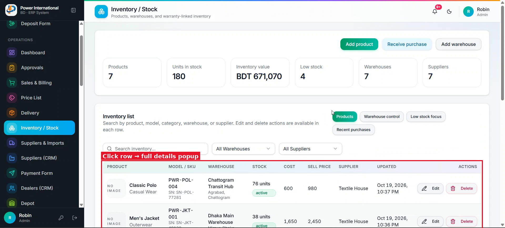

# 26 — Inventory list: one row per item, click for full details

**Project:** Power International BD ERP

## Screenshots

*`screenshots/31-inventory-list.png` — Inventory list today*

## Context (from the client meeting)
The client wants each product row to be clickable and open a popup with full details: image, model/SKU, category, units, purchase cost, selling price, stock value, low-stock level, and stock per warehouse (shown like the warehouse report, with the warehouse merged). He also wants the image visible in the list.

## Current behaviour (code)
- Inventory list in `src/app/admin/stock` (or the Inventory / Stock page). Products may have an image field; check.

## Required change
1. Make each row clickable (keyboard accessible) and open a details dialog. Row buttons (Edit, Delete) must not open it.
2. Dialog: image (large), name, model/SKU, category, supplier, warranty, purchase cost, selling price, total units, stock value at cost, low-stock level, and a per-warehouse table (Warehouse | Units | Value), using `stockByWarehouse` from prompt 25 if it is done.
3. List: show a product thumbnail (or the current "No image" placeholder), units with unit name, and cost.
4. Works at 360px and in dark mode.

## Acceptance criteria
- [ ] Clicking a product shows all its details and per-warehouse stock.

## Notes
Do this after prompt 25 so the per-warehouse table uses the new model.

## Working rules
- Open and look at the screenshot(s) above before starting; red boxes mark the area this task is about.
- The screenshots were taken from the live site in the second client meeting, before prompts 01–15 were deployed. The current code already differs in places (dates are DD/MM/YYYY, the sales status is a badge, "New sale" is gone, two-stage approval exists). Read the current code before planning.
- Show me your plan before changing code. Do not commit anything.
- Run tests only on the local emulator (`npm run test:e2e:local`), never against the live database.
- Keep the change scoped to this task. Match the existing stack: Next.js App Router, TypeScript, Tailwind, shadcn/ui, `useERP()` in `src/lib/erp/provider.tsx`, Firebase Realtime Database.
- Keep two-stage approval (prompt 02) and the ledger as the single source of dealer due intact.
- Must work on a 360px phone and in dark mode. Dates in DD/MM/YYYY.
- At the end, summarise changed files, tests run, and anything assumed or left undone.
