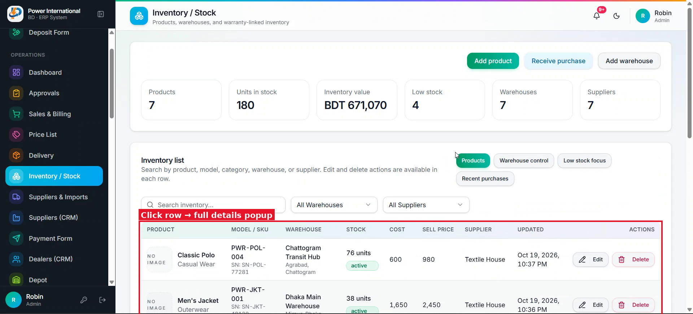

# 27 — Stock history with dates for every warehouse action

**Project:** Power International BD ERP

## Screenshots

*`screenshots/31-inventory-list.png` — Inventory / Stock page*

## Context (from the client meeting)
Every stock action should be recorded with its date so anyone can see what happened in each warehouse: stock added (purchase), transferred between warehouses, sold/delivered, adjusted, damaged/returned.

## Current behaviour (code)
- Stock changes happen in several places (receive purchase, order delivery, damage, replacement, transfer from prompt 25). There is no single stock movement log.

## Required change
1. Add a stock movement record written in the same update as every stock change: date (business date), product, warehouse, change (+/−), balance after, type (purchase / transfer in / transfer out / sale / adjustment / damage / return), reference (purchase id, order bill, etc.), and who.
2. Add a "Stock history" tab on Inventory / Stock: filters for warehouse, product, type and date range; newest first; export to Excel.
3. Show the same history (filtered) inside the product details dialog (prompt 26) and for a single warehouse from Warehouse control.
4. Do not backfill old movements unless you can rebuild them exactly from purchases and orders; if you can, write it as a dry-run script and show me.

## Acceptance criteria
- [ ] Each action in the acceptance tests of prompt 25 creates exactly one history row per warehouse affected, with the right balance.

## Notes
Do this after prompt 25.

## Working rules
- Open and look at the screenshot(s) above before starting; red boxes mark the area this task is about.
- The screenshots were taken from the live site in the second client meeting, before prompts 01–15 were deployed. The current code already differs in places (dates are DD/MM/YYYY, the sales status is a badge, "New sale" is gone, two-stage approval exists). Read the current code before planning.
- Show me your plan before changing code. Do not commit anything.
- Run tests only on the local emulator (`npm run test:e2e:local`), never against the live database.
- Keep the change scoped to this task. Match the existing stack: Next.js App Router, TypeScript, Tailwind, shadcn/ui, `useERP()` in `src/lib/erp/provider.tsx`, Firebase Realtime Database.
- Keep two-stage approval (prompt 02) and the ledger as the single source of dealer due intact.
- Must work on a 360px phone and in dark mode. Dates in DD/MM/YYYY.
- At the end, summarise changed files, tests run, and anything assumed or left undone.
