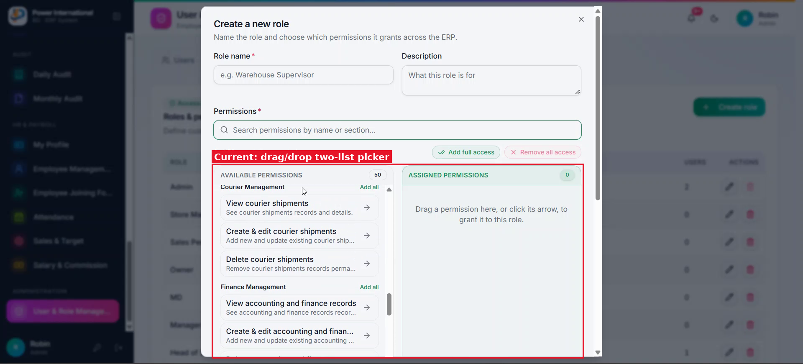

# 01 — Replace the role permission picker with a View / Create / Edit / Delete matrix

**Project:** Power International BD ERP (`erp.powerinternationalbd.com`)

## Screenshots

*`screenshots/01-role-permission-picker.png` — Current "Create a new role" dialog with the two-list drag-and-drop picker*

## Context
The client (Power International BD) finds the current two-list picker confusing for staff. They want a simple matrix: one row per menu section, one checkbox column per action.

## Current behaviour (code)
- `src/components/admin/RoleManagementPanel.tsx` → `PermissionPicker` renders "Available permissions" and "Assigned permissions" lists with drag/drop and arrow buttons.
- `src/lib/erp/defaultData.ts` → `buildPermissionCatalog()` / `moduleActions()` only produce `view`, `edit` ("Create & edit") and `delete`. There is no separate `create` action.
- `src/lib/erp/roles.ts` → `resolveRoles()` migrates legacy ids via `LEGACY_PERMISSION_MAP`.

## Required change
1. Replace `PermissionPicker` with a table that has 5 columns: **Module | View | Create | Edit | Delete**.
2. Add one row per module from the permission catalog, grouped by category (category as a group header row). Where a module has sub-sections, show them as indented child rows under the parent.
3. Each action cell is a checkbox. If an action does not exist for a module (e.g. Dashboard only has View), show a disabled "—".
4. Add a "select all" checkbox per row and per column header. Keep the existing search box, "Add full access" and "Remove all access".
5. Split the action model: add `create` to `PermissionDefinition.action` and to `moduleActions()` (label "Create {noun}"). `edit` becomes "Edit {noun}" only.
6. Backwards compatibility: in `resolveRoles()`, a stored `<module>.edit` on a role saved before this change must grant both `<module>.create` and `<module>.edit`, so no existing role loses access. Do this with a one-time flag/version, not forever, so that unchecking Create later is respected.
7. Update every `hasPermission('<module>.edit')` check that guards *creating* a record (e.g. "New …" / "Add …" buttons, submit of a new record) to `<module>.create`. Leave checks that guard editing existing records on `.edit`. There are ~51 `.edit` call sites; go through each.
8. Mobile: the matrix must be usable on a phone. Make the Module column sticky and let the table scroll horizontally inside its own container.

## Acceptance criteria
- [ ] Creating/editing a role uses only the matrix; saving produces the same `permissions: string[]` shape in Firebase.
- [ ] Existing roles keep exactly the access they had (verify Owner, Manager, Head of Sales).
- [ ] A role with View+Edit but not Create cannot see "Add/New" buttons for that module but can edit existing records.
- [ ] `npm run build` and existing Playwright tests pass.

## Notes
Do not change `database.rules.json` / Firebase rules.

## Working rules
- Open and look at the screenshot(s) above before starting; red boxes mark the area this task is about.
- Keep the change scoped to this task. Do not refactor unrelated code.
- Match the existing stack and style: Next.js App Router, TypeScript, Tailwind, shadcn/ui components in `src/components/ui`, data via `useERP()` (`src/lib/erp/provider.tsx`) and Firebase Realtime Database.
- UI text stays in English, consistent with the rest of the app.
- Must work on mobile (most users are on phones) and in dark mode.
- Run `npm run build` and the relevant Playwright tests; add a test when the task changes behaviour.
- At the end, summarise which files changed and anything you could not do or had to assume.
