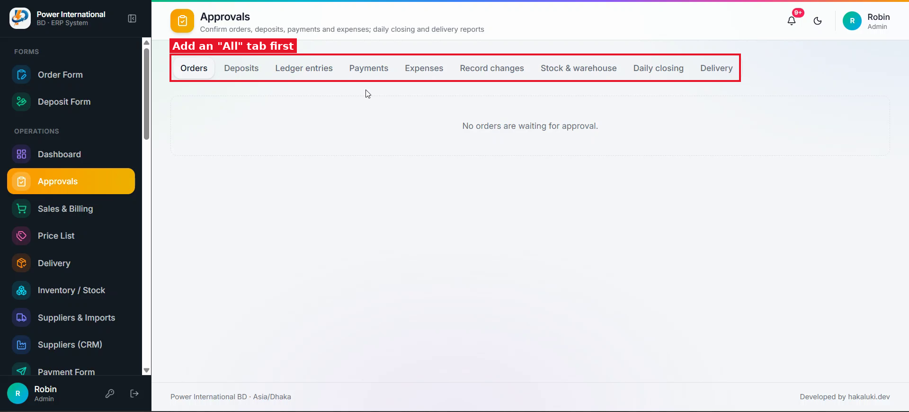

# 03 — Add an "All" tab to the Approvals page

**Project:** Power International BD ERP (`erp.powerinternationalbd.com`)

## Screenshots

*`screenshots/02-approvals-tabs.png` — Tabs today: Orders, Deposits, Ledger entries, Payments, Expenses, Record changes, Stock & warehouse, Daily closing, Delivery*

## Context
The client wants to see every pending approval in one list instead of opening each tab.

## Current behaviour (code)
- `src/app/admin/approvals/page.tsx` → `Tab` union and `tabs` array; each tab renders its own component (`OrderApprovals`, `SubmissionApprovals`, `LedgerEntryApprovals`, `ChangeApprovals`).

## Required change
1. Add an **All** tab as the first tab and make it the default.
2. It lists every pending item from Orders, Deposits, Ledger entries, Payments, Expenses and Record changes, sorted by entry date (newest first), each with a type badge (Order / Deposit / …).
3. Each item keeps exactly the same card content and the same approve / reject / edit actions and permission rules as in its own tab. Reuse the existing card components; do not duplicate logic.
4. The All tab badge shows the total pending count.
5. Report tabs (Stock & warehouse, Daily closing, Delivery) are not part of All.

## Acceptance criteria
- [ ] Approving or rejecting from All has the same effect as from the specific tab.
- [ ] Counts on All equal the sum of the individual tab counts.

## Working rules
- Open and look at the screenshot(s) above before starting; red boxes mark the area this task is about.
- Keep the change scoped to this task. Do not refactor unrelated code.
- Match the existing stack and style: Next.js App Router, TypeScript, Tailwind, shadcn/ui components in `src/components/ui`, data via `useERP()` (`src/lib/erp/provider.tsx`) and Firebase Realtime Database.
- UI text stays in English, consistent with the rest of the app.
- Must work on mobile (most users are on phones) and in dark mode.
- Run `npm run build` and the relevant Playwright tests; add a test when the task changes behaviour.
- At the end, summarise which files changed and anything you could not do or had to assume.
