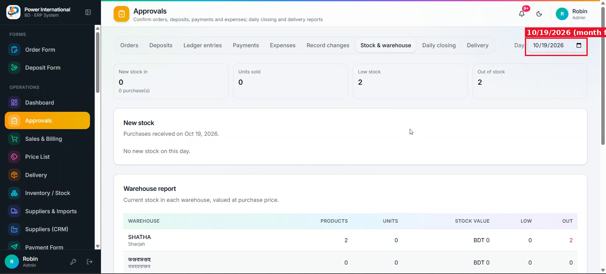

# 04 — Show all dates as DD/MM/YYYY

**Project:** Power International BD ERP (`erp.powerinternationalbd.com`)

## Screenshots

*`screenshots/03-sales-dates-mmddyyyy.png` — "Oct 9, 2026" in tables and mm/dd/yyyy in date inputs*

*`screenshots/04-approvals-day-input.png` — Approvals day selector showing 10/19/2026*

## Context
The client wants day first everywhere: DD/MM/YYYY. Month-first is confusing for the team.

## Current behaviour (code)
- `src/lib/erp/utils.ts` → `formatDate()` and `formatDateTime()` use `Intl.DateTimeFormat('en-BD', { dateStyle: 'medium' })` → "Oct 9, 2026".
- Ad-hoc formatting: `DashboardScreen.tsx` (`toLocaleDateString('en-BD')`), `finance/page.tsx`, etc.

## Required change
1. Change `formatDate` to output `DD/MM/YYYY` and `formatDateTime` to `DD/MM/YYYY, hh:mm a` (fixed format, not locale-dependent).
2. Replace ad-hoc date formatting with these helpers everywhere: tables, cards, approval cards, PDFs, invoices, print views, Excel exports, WhatsApp/SMS messages.
3. Chart axis labels that show only a month name (e.g. "Oct") can stay as they are.
4. Storage format does not change (ISO / `YYYY-MM-DD`). Display only.

## Acceptance criteria
- [ ] `grep` finds no remaining `dateStyle: 'medium'` or `toLocaleDateString` used for full dates.
- [ ] Invoice, credit sheet PDF and sales export all show DD/MM/YYYY.

## Notes
Date *inputs* are handled in prompt 05.

## Working rules
- Open and look at the screenshot(s) above before starting; red boxes mark the area this task is about.
- Keep the change scoped to this task. Do not refactor unrelated code.
- Match the existing stack and style: Next.js App Router, TypeScript, Tailwind, shadcn/ui components in `src/components/ui`, data via `useERP()` (`src/lib/erp/provider.tsx`) and Firebase Realtime Database.
- UI text stays in English, consistent with the rest of the app.
- Must work on mobile (most users are on phones) and in dark mode.
- Run `npm run build` and the relevant Playwright tests; add a test when the task changes behaviour.
- At the end, summarise which files changed and anything you could not do or had to assume.
