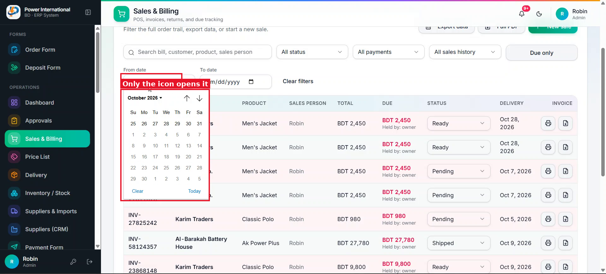
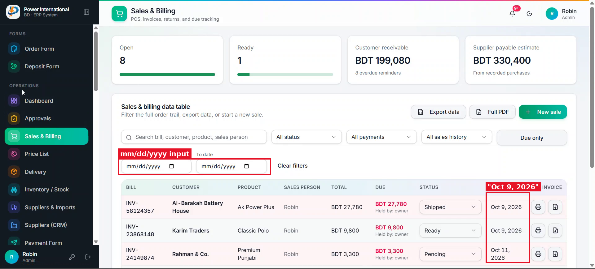

# 05 — Shared DateInput: DD/MM/YYYY, whole box clickable, tidy calendar

**Project:** Power International BD ERP (`erp.powerinternationalbd.com`)

## Screenshots

*`screenshots/05-date-picker-calendar.png` — Native date picker – only the small calendar icon opens it on desktop*

*`screenshots/03-sales-dates-mmddyyyy.png` — Inputs show mm/dd/yyyy*

## Context
Native `<input type="date">` shows mm/dd/yyyy (browser locale) and on desktop only the icon opens the calendar. Client wants the whole box clickable on desktop and mobile, and a calendar that fits the box neatly.

## Current behaviour (code)
- 43 places use `<Input type="date">` (e.g. `SalesScreen.tsx`, `approvals/page.tsx`, `order-form/page.tsx`, `deposit/page.tsx`, `credit-sheet/page.tsx`, …).

## Required change
1. Create `src/components/ui/date-input.tsx`. API compatible with current usage: `value` / `onChange` in `YYYY-MM-DD`, plus `min`, `max`, `required`, `disabled`, `className`, `name`.
2. Displays the value as `DD/MM/YYYY`; typing in that format is allowed and validated.
3. Clicking anywhere on the box opens the calendar (desktop and mobile).
4. Calendar is a popover anchored to the input, aligned to its left edge, roughly the input's width (with a sensible minimum), never overflowing the viewport. Includes Today and Clear. Week starts Saturday or Sunday – keep current behaviour.
5. Must still work inside forms with native `required` validation (use a hidden input or `setCustomValidity`).
6. Replace every `<Input type="date">` with `DateInput`.

## Acceptance criteria
- [ ] No `type="date"` remains in `src/`.
- [ ] Filters (Sales from/to, Approvals Day) still filter correctly.
- [ ] Works with keyboard and on a 360px-wide phone.

## Working rules
- Open and look at the screenshot(s) above before starting; red boxes mark the area this task is about.
- Keep the change scoped to this task. Do not refactor unrelated code.
- Match the existing stack and style: Next.js App Router, TypeScript, Tailwind, shadcn/ui components in `src/components/ui`, data via `useERP()` (`src/lib/erp/provider.tsx`) and Firebase Realtime Database.
- UI text stays in English, consistent with the rest of the app.
- Must work on mobile (most users are on phones) and in dark mode.
- Run `npm run build` and the relevant Playwright tests; add a test when the task changes behaviour.
- At the end, summarise which files changed and anything you could not do or had to assume.
