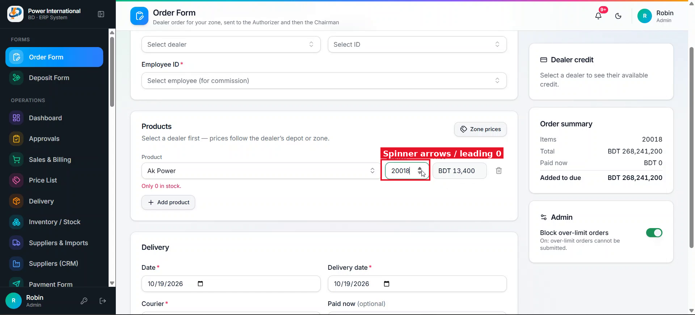

# 06 — Numeric inputs: no spinner arrows, no stuck leading zero

**Project:** Power International BD ERP (`erp.powerinternationalbd.com`)

## Screenshots

*`screenshots/06-quantity-spinner.png` — Order Form quantity: spinner arrows and the leading 0 issue*

## Context
On the Order Form, typing into a field that shows 0 leaves the 0 in front (e.g. "020000"), and the up/down spinner (plus mouse-wheel) changes values by accident.

## Current behaviour (code)
- 81 inputs use `type="number"`, e.g. Quantity and "Paid now" in `src/app/admin/order-form/page.tsx`.
- `src/components/ui/input.tsx` is a plain wrapper.

## Required change
1. Hide spinner arrows (CSS for webkit and Firefox) and prevent the mouse wheel from changing the value.
2. When the value is `0` (or empty) and the user types a digit, the digit replaces the 0. Strip leading zeros on input ("0200" → "200"), keep "0." for decimals.
3. Select the whole value on focus so typing overwrites it.
4. Use `inputMode="decimal"` (or `numeric` for integer fields) so phones show the number keyboard.
5. Implement once (a `NumberInput` component or inside `Input` when `type="number"`) and apply to all 81 places.

## Acceptance criteria
- [ ] Typing "2000" into a field showing 0 gives 2000.
- [ ] Scrolling the page over a focused number field does not change it.
- [ ] Unit test for the leading-zero logic.

## Working rules
- Open and look at the screenshot(s) above before starting; red boxes mark the area this task is about.
- Keep the change scoped to this task. Do not refactor unrelated code.
- Match the existing stack and style: Next.js App Router, TypeScript, Tailwind, shadcn/ui components in `src/components/ui`, data via `useERP()` (`src/lib/erp/provider.tsx`) and Firebase Realtime Database.
- UI text stays in English, consistent with the rest of the app.
- Must work on mobile (most users are on phones) and in dark mode.
- Run `npm run build` and the relevant Playwright tests; add a test when the task changes behaviour.
- At the end, summarise which files changed and anything you could not do or had to assume.
