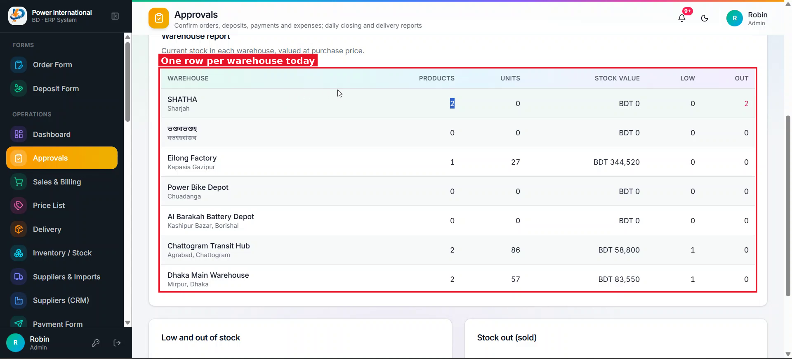

# 07 — Warehouse report: one row per product with merged warehouse cells

**Project:** Power International BD ERP (`erp.powerinternationalbd.com`)

## Screenshots

*`screenshots/08-warehouse-report-current.png` — Current report: one row per warehouse with Products / Units / Stock value / Low / Out*

## Context
In Approvals → Stock & warehouse, the client wants to see each product inside each warehouse, like Excel "merge cells" for the warehouse name.

## Current behaviour (code)
- `src/components/admin/approvals/ApprovalReports.tsx` → `StockReport` builds `warehouses` (aggregated counts) and renders columns Warehouse | Products | Units | Stock value | Low | Out.
- Each product has `warehouseId`, `stockQty`, `purchasePrice`, `minStock`, `status`.

## Required change
1. New columns, in order: **Warehouse | Product name | Quantity | Purchase price | Stock value | Low-stock qty**.
2. One row per product. The Warehouse cell spans all of that warehouse's product rows (`rowSpan`), shows the name (and location below it) once, vertically centered.
3. Stock value = quantity × purchase price.
4. Low-stock qty = the product's `minStock`; highlight the row (amber) when `stockQty <= minStock`, red when stock is 0.
5. Remove the "Out" column.
6. Add a subtotal row per warehouse (quantity, stock value) and a grand total at the bottom.
7. Keep "No warehouse" grouping for products without a valid warehouse. Apply the same layout to print / PDF if the report is printable.

## Acceptance criteria
- [ ] SHATHA with 2 products shows "SHATHA" once spanning 2 rows, each product with its own qty/price/value.
- [ ] Totals match the previous aggregated values.

## Notes
Assumption: "Low-stock qty" means the minimum-stock level. Confirm with the client.

## Working rules
- Open and look at the screenshot(s) above before starting; red boxes mark the area this task is about.
- Keep the change scoped to this task. Do not refactor unrelated code.
- Match the existing stack and style: Next.js App Router, TypeScript, Tailwind, shadcn/ui components in `src/components/ui`, data via `useERP()` (`src/lib/erp/provider.tsx`) and Firebase Realtime Database.
- UI text stays in English, consistent with the rest of the app.
- Must work on mobile (most users are on phones) and in dark mode.
- Run `npm run build` and the relevant Playwright tests; add a test when the task changes behaviour.
- At the end, summarise which files changed and anything you could not do or had to assume.
