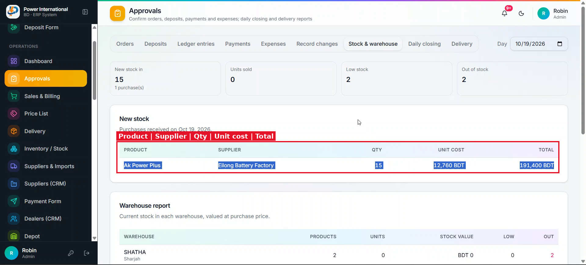
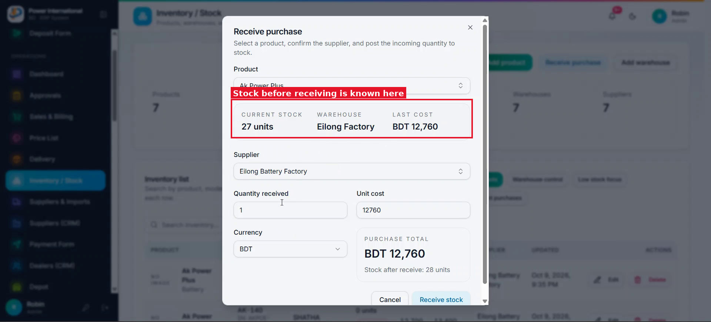

# 08 — New stock table: previous qty, new qty, totals

**Project:** Power International BD ERP (`erp.powerinternationalbd.com`)

## Screenshots

*`screenshots/09-new-stock-table-current.png` — Current New stock table*

*`screenshots/10-receive-purchase-dialog.png` — Receive purchase dialog already knows the current stock before receiving*

## Context
In Approvals → Stock & warehouse → New stock, the client wants to see what the stock was before the purchase and what it is after.

## Current behaviour (code)
- `PurchaseRecord` (`src/lib/erp/types.ts`) has no record of the stock before/after.
- Receive purchase is written in `src/lib/erp/provider.tsx` (around `purchases/${purchaseId}`).
- `StockReport` renders Product | Supplier | Qty | Unit cost | Total.

## Required change
1. Add optional `stockBefore` and `stockAfter` to `PurchaseRecord`; set them when the purchase is received (from the product's `stockQty` at that moment).
2. New stock table columns, in order: **Product | Supplier | Previous stock qty | New stock qty | Unit cost (new stock) | Total qty | Total value**.
3. Total qty = previous + new. Total value = total qty × unit cost.
4. Older purchases without `stockBefore` show "—" for previous qty and total qty (do not guess).

## Acceptance criteria
- [ ] Receiving 15 units of a product that had 27 shows 27 | 15 | … | 42.

## Notes
Assumption: Total value = total qty × the new unit cost. Confirm with the client.

## Working rules
- Open and look at the screenshot(s) above before starting; red boxes mark the area this task is about.
- Keep the change scoped to this task. Do not refactor unrelated code.
- Match the existing stack and style: Next.js App Router, TypeScript, Tailwind, shadcn/ui components in `src/components/ui`, data via `useERP()` (`src/lib/erp/provider.tsx`) and Firebase Realtime Database.
- UI text stays in English, consistent with the rest of the app.
- Must work on mobile (most users are on phones) and in dark mode.
- Run `npm run build` and the relevant Playwright tests; add a test when the task changes behaviour.
- At the end, summarise which files changed and anything you could not do or had to assume.
