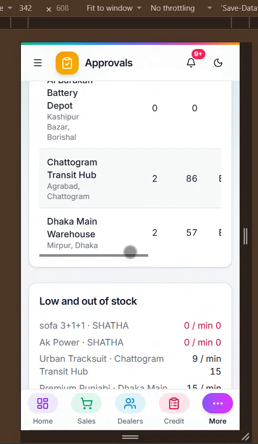
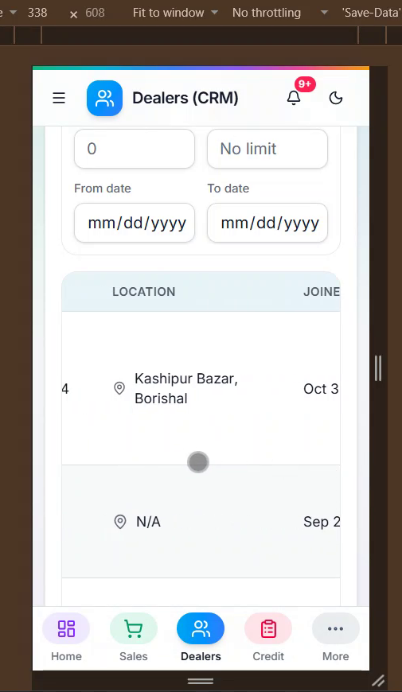

# 09 — Compact tables on mobile

**Project:** Power International BD ERP (`erp.powerinternationalbd.com`)

## Screenshots

*`screenshots/11a-mobile-approvals-scroll.png` — Approvals table on a phone*

*`screenshots/11b-mobile-dealers-scroll.png` — Dealers (CRM) on a phone – heavy sideways scrolling*

## Context
Almost all users will use phones. Tables (especially Dealers CRM and the Credit sheet) need a lot of left/right scrolling. The client asked for smaller text so more fits.

## Current behaviour (code)
- `src/components/ui/table.tsx` uses desktop padding/size for all breakpoints.
- Pages wrap tables in `overflow-x-auto`.

## Required change
1. Below `md`: table text `text-xs`, cell padding reduced (e.g. `px-2 py-1.5`), headers `text-[11px]`, remove unnecessary `min-w`/`whitespace-nowrap` on long text columns so they wrap.
2. Do this in `table.tsx` so it applies everywhere, then check Dealers (CRM), Credit sheet, Sales & Billing, Approvals and Suppliers (CRM).
3. Where horizontal scroll is unavoidable, make the first (name) column sticky with a background.
4. Desktop appearance must not change.

## Acceptance criteria
- [ ] On a 360px viewport the Dealers table shows name + at least 2 more columns without scrolling.
- [ ] No layout change at ≥ 1024px.

## Working rules
- Open and look at the screenshot(s) above before starting; red boxes mark the area this task is about.
- Keep the change scoped to this task. Do not refactor unrelated code.
- Match the existing stack and style: Next.js App Router, TypeScript, Tailwind, shadcn/ui components in `src/components/ui`, data via `useERP()` (`src/lib/erp/provider.tsx`) and Firebase Realtime Database.
- UI text stays in English, consistent with the rest of the app.
- Must work on mobile (most users are on phones) and in dark mode.
- Run `npm run build` and the relevant Playwright tests; add a test when the task changes behaviour.
- At the end, summarise which files changed and anything you could not do or had to assume.
