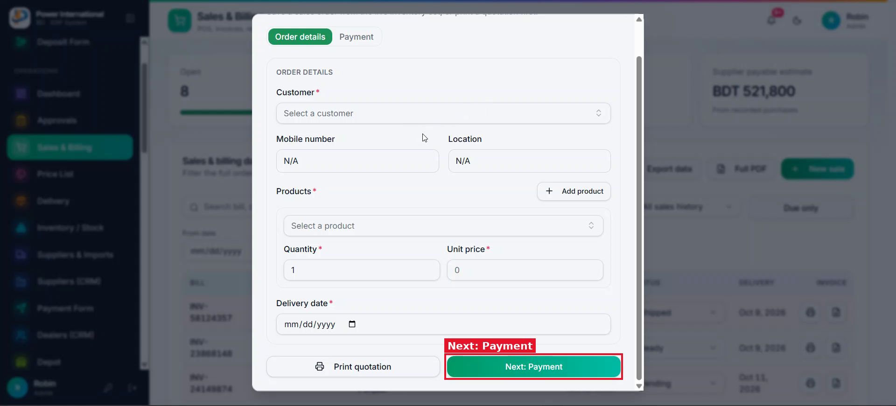
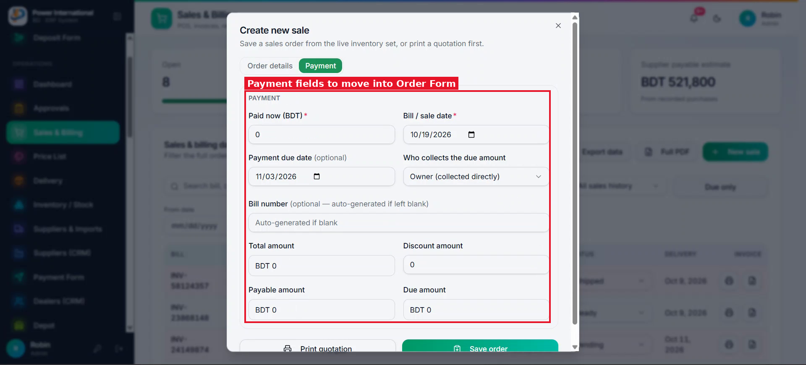
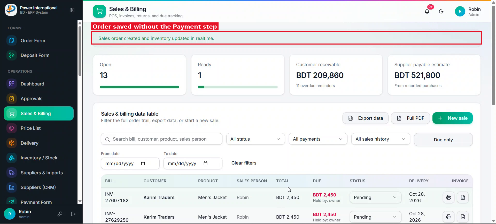
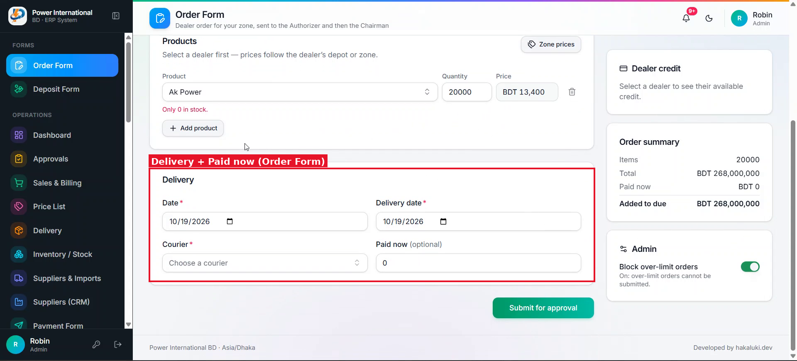

# 10 — Remove "New sale"; add an optional Payment section to the Order Form

**Project:** Power International BD ERP (`erp.powerinternationalbd.com`)

## Screenshots

*`screenshots/12-new-sale-order-details.png` — Sales & Billing → New sale dialog (duplicate of the Order Form)*

*`screenshots/13-new-sale-payment-section.png` — Payment fields in the New sale dialog*

*`screenshots/14-next-payment-autosaves.png` — Bug: clicking "Next: Payment" saved the order immediately*

*`screenshots/07-order-form-paid-now.png` — Order Form today: only an optional "Paid now"*

## Context
Sales must come only from the Order Form (which goes through approval). "New sale" in Sales & Billing duplicates it and confuses users. Sales & Billing should be for viewing.

## Current behaviour (code)
- `src/components/admin/SalesScreen.tsx` → "New sale" button + dialog with Order details / Payment sections.
- Bug root cause: "Next: Payment" (`type="button"`) and "Save order" (`type="submit"`) are rendered conditionally in the same spot without keys, so React reuses the DOM button and the same click submits the form.
- `src/app/admin/order-form/page.tsx` has a standalone "Paid now (optional)" field.

## Required change
1. Remove the "New sale" button, the dialog and now-unused code from `SalesScreen.tsx` (keep quotation printing only if used elsewhere).
2. On the Order Form add a **Payment** checkbox. Unchecked (default): nothing paid, the full amount goes to due.
3. Checked: show a Payment section with Paid now, Payment due date (default +15 days), Who collects the due (owner / courier / bank / bKash / Nagad / DBBL), Discount, Bill number (optional), and read-only Total, Payable, Due.
4. Remove the standalone "Paid now" field; the Order summary card uses the new values.
5. Pass the new fields through `submitOrderRequest` → approved order (`paid`, `discount`, `paymentDueDate`, `dueReference`, `billNumber`).
6. Do not reproduce the button-swap pattern; if steps are needed, give buttons distinct `key`s or keep one submit button.

## Acceptance criteria
- [ ] No "New sale" in Sales & Billing.
- [ ] Order with Payment unchecked → due = total. Checked with paid 5,000 of 10,000 → due 5,000 after approval.

## Working rules
- Open and look at the screenshot(s) above before starting; red boxes mark the area this task is about.
- Keep the change scoped to this task. Do not refactor unrelated code.
- Match the existing stack and style: Next.js App Router, TypeScript, Tailwind, shadcn/ui components in `src/components/ui`, data via `useERP()` (`src/lib/erp/provider.tsx`) and Firebase Realtime Database.
- UI text stays in English, consistent with the rest of the app.
- Must work on mobile (most users are on phones) and in dark mode.
- Run `npm run build` and the relevant Playwright tests; add a test when the task changes behaviour.
- At the end, summarise which files changed and anything you could not do or had to assume.
