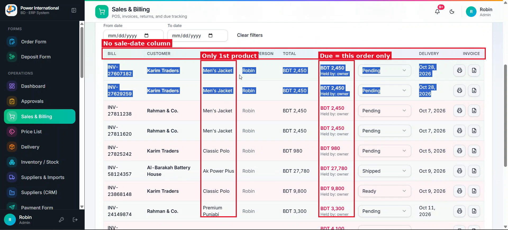
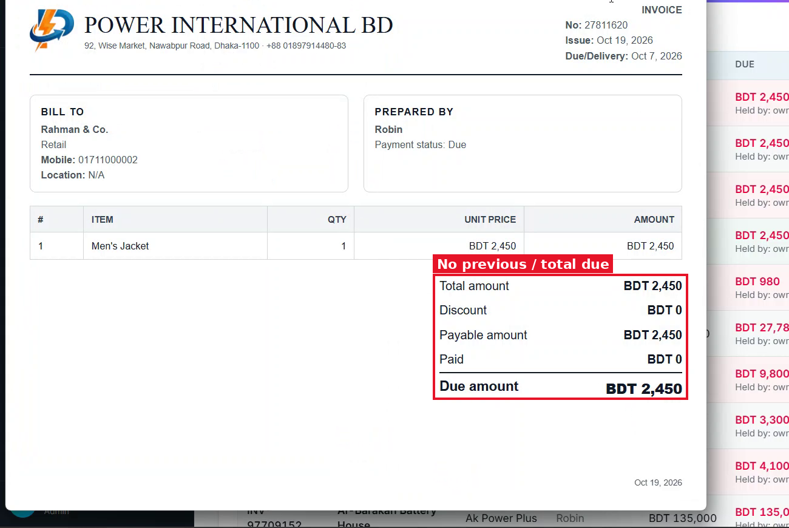

# 12 — Due column and invoice show the cumulative customer due (snapshot)

**Project:** Power International BD ERP (`erp.powerinternationalbd.com`)

## Screenshots

*`screenshots/15-sales-table-columns.png` — Due column shows only this order's due*

*`screenshots/17-invoice-no-previous-due.png` — Invoice has no previous due / total due*

## Context
Most orders are fully on credit, so the order-only due is not useful. The client wants the invoice to show the previous due + this invoice = total due at that moment, and that figure must not change later.

## Current behaviour (code)
- `OrderRecord` has `due` for this order only.
- `buildSalesDocumentHtml` in `SalesScreen.tsx` prints Total / Discount / Payable / Paid / Due.
- Customer balance can be built with `buildCustomerLedger` + `withRunningBalance` in `src/lib/erp/ledger.ts`.

## Required change
1. When an order is finally approved, compute and store `previousDue` (customer's balance just before this order, by entry date) and `totalDueAfter` = previousDue + this order's due.
2. These are snapshots: later payments, deposits or orders must not change them on this order/invoice.
3. Sales table Due column shows `totalDueAfter` (label "Total due"); keep the order-only due as a small secondary line.
4. Invoice totals add rows **Previous due** and **Total due** after "Due amount".
5. Older orders without the snapshot fall back to the order-only due (optionally a one-time backfill script in `scripts/`).

## Acceptance criteria
- [ ] Customer with 1,000 due places a 2,450 order (unpaid) → invoice: Previous due 1,000, Total due 3,450. A later payment does not change that invoice.

## Working rules
- Open and look at the screenshot(s) above before starting; red boxes mark the area this task is about.
- Keep the change scoped to this task. Do not refactor unrelated code.
- Match the existing stack and style: Next.js App Router, TypeScript, Tailwind, shadcn/ui components in `src/components/ui`, data via `useERP()` (`src/lib/erp/provider.tsx`) and Firebase Realtime Database.
- UI text stays in English, consistent with the rest of the app.
- Must work on mobile (most users are on phones) and in dark mode.
- Run `npm run build` and the relevant Playwright tests; add a test when the task changes behaviour.
- At the end, summarise which files changed and anything you could not do or had to assume.
