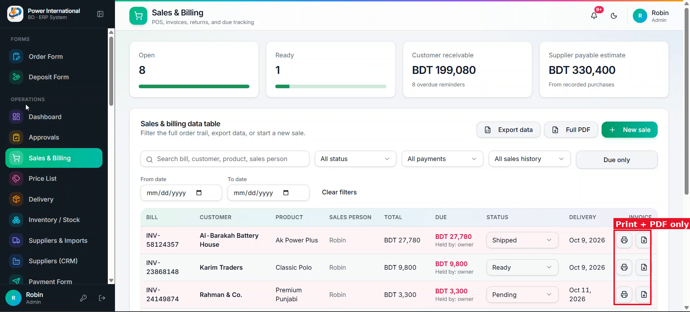

# 13 — Download invoice as JPG

**Project:** Power International BD ERP (`erp.powerinternationalbd.com`)

## Screenshots

*`screenshots/18-invoice-buttons.png` — Only Print and PDF are available*

## Context
Invoices are forwarded on WhatsApp; PDFs are hard to view on phones and staff currently take screenshots.

## Current behaviour (code)
- `downloadInvoicePdf` uses `downloadDocumentPdf(buildSalesDocumentHtml('Invoice', order, false), …)` from `credit-sheet/printSheet.ts`.
- `html-to-image` is already a dependency.

## Required change
1. Add a JPG button next to Print and PDF (table row and invoice dialog).
2. Render the same invoice HTML (non-auto-print variant) in an off-screen iframe, wait for fonts/images, capture with `html-to-image` `toJpeg` at pixelRatio ≈ 2, white background, quality ≈ 0.92.
3. File name `invoice-<billNumber>.jpg`. Put the helper next to `downloadDocumentPdf` so other documents can reuse it.

## Acceptance criteria
- [ ] The JPG matches the PDF layout and is readable on a phone when zoomed.

## Working rules
- Open and look at the screenshot(s) above before starting; red boxes mark the area this task is about.
- Keep the change scoped to this task. Do not refactor unrelated code.
- Match the existing stack and style: Next.js App Router, TypeScript, Tailwind, shadcn/ui components in `src/components/ui`, data via `useERP()` (`src/lib/erp/provider.tsx`) and Firebase Realtime Database.
- UI text stays in English, consistent with the rest of the app.
- Must work on mobile (most users are on phones) and in dark mode.
- Run `npm run build` and the relevant Playwright tests; add a test when the task changes behaviour.
- At the end, summarise which files changed and anything you could not do or had to assume.
