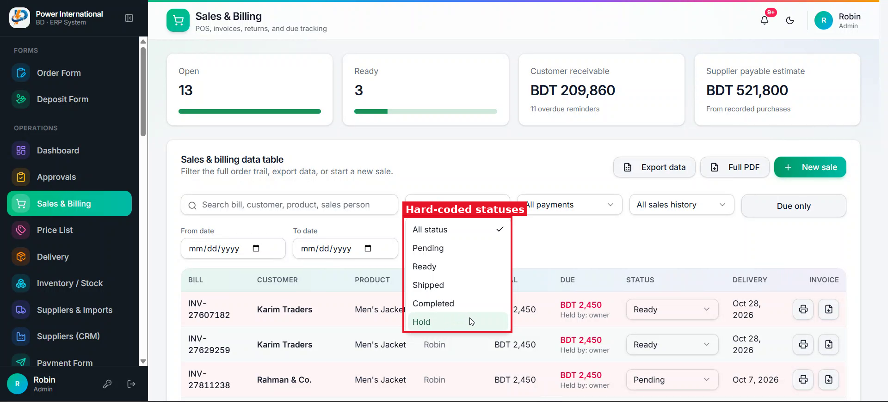

# 14 — Admin-configurable order statuses

**Project:** Power International BD ERP (`erp.powerinternationalbd.com`)

## Screenshots

*`screenshots/16-status-options.png` — Hard-coded statuses: Pending, Ready, Shipped, Completed, Hold*

## Context
The client's workflow may change (rename "Shipped" to "Delivered", remove "Ready", add steps). Today that needs a code change. They also do not want the status dropdown inside the table.

## Current behaviour (code)
- `OrderStatus` type in `src/lib/erp/types.ts`; status options hard-coded twice in `SalesScreen.tsx` (filter and inline `Select`); `getReadableOrderState` in utils.

## Required change
1. Store a list of statuses in settings (`id`, `label`, `color`, `order`, `isFinal`). Seed it with the current five.
2. Add a settings UI (admin only) to add, rename, recolor, reorder and delete statuses. Deleting a status in use requires picking a replacement.
3. Replace the inline status `Select` in the table with a read-only colored badge. Status can be changed from the order dialog (prompt 11) for users with `sales.edit`.
4. Status filter and any reports use the configured list.

## Acceptance criteria
- [ ] Renaming "Shipped" to "Delivered" in settings updates the table, filter and dialog without a deploy.

## Notes
The client has not fully decided which statuses they need – build the mechanism, keep the current five as defaults.

## Working rules
- Open and look at the screenshot(s) above before starting; red boxes mark the area this task is about.
- Keep the change scoped to this task. Do not refactor unrelated code.
- Match the existing stack and style: Next.js App Router, TypeScript, Tailwind, shadcn/ui components in `src/components/ui`, data via `useERP()` (`src/lib/erp/provider.tsx`) and Firebase Realtime Database.
- UI text stays in English, consistent with the rest of the app.
- Must work on mobile (most users are on phones) and in dark mode.
- Run `npm run build` and the relevant Playwright tests; add a test when the task changes behaviour.
- At the end, summarise which files changed and anything you could not do or had to assume.
